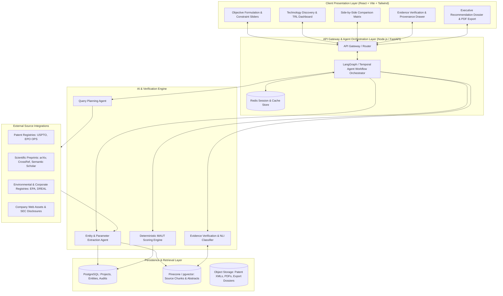
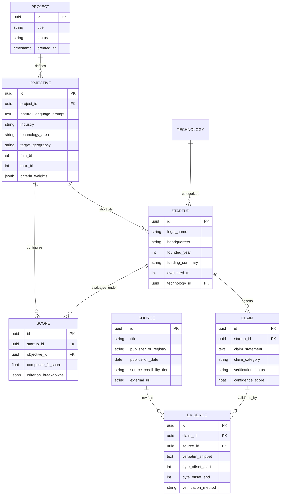

# Product Management Case Study: ScoutIQ
## Deliverable 04-B: System Architecture & Technical Feasibility

> **Document Status:** Product Management Case Study & Prototype Specification  
> **Notice:** This document is part of a Product Management case study. ScoutIQ is a conceptual product and working software prototype, not a deployed commercial application. All architectural designs, data models, cost projections, and feasibility metrics described herein are conceptual estimates and constitute **illustrative data** created exclusively for demonstration purposes.

---

### 1. High-Level Component Architecture

The ScoutIQ platform architecture separates interactive client state from asynchronous agentic discovery and evidence verification pipelines.



---

### 2. Core Data Model & Schema Specifications

The relational and entity schema enforces strict relational provenance between high-level project objectives, discovered startups, individual technical claims, and primary source citations.



---

### 3. Tech Stack Evaluation & Build-vs-Buy Decision

| Layer | Component Options | Selected Architecture | Build vs. Buy Justification |
| :--- | :--- | :--- | :--- |
| **Frontend** | React 19 + Vite + Tailwind CSS | **React 19 + Tailwind CSS** | **Build:** Custom interactive data visualizations (TRL distribution, evidence drawers, multi-slider weight engines) require tailor-made enterprise UI components with low latency. |
| **Orchestration** | LangChain vs. LangGraph vs. Temporal | **LangGraph / Temporal** | **Build on Framework:** Technology scouting requires cyclic multi-step evaluation with human-in-the-loop checkpoints. LangGraph handles stateful agentic loops with checkpointing. |
| **Foundation LLMs** | Gemini 1.5 Pro vs. GPT-4o vs. Llama 3.3 | **Hybrid: Gemini 1.5 Pro + GPT-4o** | **Buy (API):** Gemini 1.5 Pro's 2M context window handles full patent dossiers and 100-page academic papers without chunk fragmentation. GPT-4o provides rapid extraction. |
| **Vector Database** | Pinecone vs. Qdrant vs. pgvector | **pgvector (PostgreSQL)** | **Hybrid:** Using PostgreSQL with `pgvector` co-locates relational project metadata, strict audit logs, and document chunk embeddings in a single acid-compliant database. |
| **Patent & Lit Search** | Custom Scrapers vs. Specialized APIs | **Commercial APIs (IFI Claims / EPO OPS)** | **Buy:** Building and maintaining scrapers across 90+ global patent authorities is an operational nightmare. Licensing established patent APIs ensures statutory compliance. |

---

### 4. Cost and Latency Estimates (*Illustrative Projections*)

*Note: All estimates reflect projected enterprise production volume assuming an average of 40 scouting briefs processed per month per enterprise client.*

#### 4.1 Latency Budget (Target: $\le 60$ Seconds End-to-End)
* **Stage 1 (Objective Decomposition):** 2.0s
* **Stage 2 & 3 (Parallel Query Planning & Source Ingestion):** 18.0s (utilizing async parallel HTTP pipelines)
* **Stage 4 (Multi-Document Entity & Parameter Extraction):** 15.0s (batched structured LLM calls across top 15 candidate entities)
* **Stage 5 (Evidence Verification & NLI Cross-Check):** 12.0s
* **Stage 6 & 7 (Scoring & Executive Dossier Generation):** 5.0s
* **Total Estimated Processing Time:** **$\approx 52.0$ seconds**

#### 4.2 Unit Economics & Cost per Scouting Brief (*Illustrative*)
* **LLM Token Costs:**
  * Context ingestion: ~600,000 input tokens across 20 source documents @ \$1.25/1M tokens = \$0.75
  * Extraction & synthesis: ~40,000 output tokens @ \$5.00/1M tokens = \$0.20
* **External API & Patent Queries:** ~50 targeted registry calls @ \$0.03/query = \$1.50
* **Compute & Vector Storage Infrastructure:** Amortized = \$0.45
* **Total Direct COGS per Completed Brief:** **$\approx \$2.90$**
* *Enterprise Gross Margin:* At a contemplated enterprise SaaS pricing of \$35,000/year for 250 briefs/year, direct gross margins exceed **95%**.

---

### 5. Hallucination & Reliability Risk Mitigation

```
+-----------------------------------------------------------------------------------+
|                        FOUR PILLARS OF HALLUCINATION DEFENSE                      |
+-----------------------------------------------------------------------------------+
| 1. Mandatory Text Span Grounding: Extracted metrics require exact character offsets.|
| 2. Programmatic Unit & Range Validation: Regex bounds prevent unit errors.        |
| 3. Explicit Doubt Signaling: Unverified claims are badged "Could Not Be Verified".|
| 4. Dual-Model Cross-Examination: Auditor model audits extractor model findings.   |
+-----------------------------------------------------------------------------------+
```

1. **Mandatory Text Span Grounding:** The extraction pipeline rejects any entity attribute (e.g., recovery yield percentage) that cannot provide an exact verbatim substring match and character byte-offset within the primary ingested document.
2. **Programmatic Unit & Range Validation:** Extracted quantitative values are validated via deterministic Pydantic schemas. If an extraction claims "105% lithium recovery" or "continuous operation at 4,000°C", the system trips an out-of-bounds validation exception.
3. **Explicit Doubt Signaling:** The system penalizes ambiguity. If a source cannot be found within the indexed corpus, the system is explicitly prohibited from guessing; it must assign `Could Not Be Verified`.
4. **Dual-Model Cross-Examination:** An independent "Auditor Agent" receives the extracted claim and source snippet without seeing the Extractor's rationale, verifying whether the conclusion follows logically from the text.

---

### 6. Model Evaluation Framework & Quality Benchmarks

To ensure enterprise-grade reliability, ScoutIQ employs a three-pronged evaluation methodology:

1. **The Golden Benchmark Dataset (50 Historical Briefs):**  
   Curated corpus of 50 historical corporate technology scouting briefs with human-verified ground truth rankings, patent citations, and laboratory test outcomes.
2. **Key Automated Evaluation Metrics:**
   * **Source-Attribution Precision:** Percentage of cited sources that actually contain the referenced claim (Target: $>98\%$).
   * **Verification Classification Accuracy:** Accuracy of the 4-tier badge classification against an expert human metallurgist/chemist audit (Target: $>92\%$).
   * **Hallucination Rate:** Frequency of ungrounded entities or fabricated patent numbers (Target: $<0.5\%$).
3. **Continuous Human-in-the-Loop Sampling:** 10% of all generated briefs undergo manual review by a domain specialist to detect emerging linguistic or technical drift.

---

### 7. Technical Feasibility Analysis & Final Verdict

#### What Is Hard (The Real Engineering Challenges)
1. **Chemical & Engineering Entity Resolution:** Distinguishing between different chemical nomenclature (e.g., *lithium carbonate* vs. *lithium hydroxide monohydrate* vs. *mixed cathode black mass*) requires specialized domain tokenization.
2. **Patent Legal Status Discrepancies:** Tracking statutory patent status across jurisdictions (filed vs. published vs. granted vs. abandoned) requires robust handling of international legal status databases with variable latency.
3. **Separating Marketing Narrative from Physical Reality:** Startups frequently use hyperbolic press releases to announce "partnerships" that are merely non-binding memoranda of understanding (MOUs). Classifying these accurately requires cross-referencing corporate securities filings.

#### Final Technical Feasibility Verdict: **FEASIBLE with Guardrails**
* **Verdict:** Building an enterprise scouting and evidence verification engine is technically viable using modern long-context foundation models combined with deterministic verification layers.
* **Key Strategic Caveat:** The solution must avoid positioning itself as an autonomous deal-making bot. By positioning ScoutIQ as an **analyst accelerator with an auditable evidence chain**, enterprise users embrace the platform as an indispensable intelligence layer that drastically compresses research cycles while keeping human technical leaders in full governance control.

---
*End of Deliverable 04-B: System Architecture & Technical Feasibility (ScoutIQ PM Case Study — Illustrative Data).*
